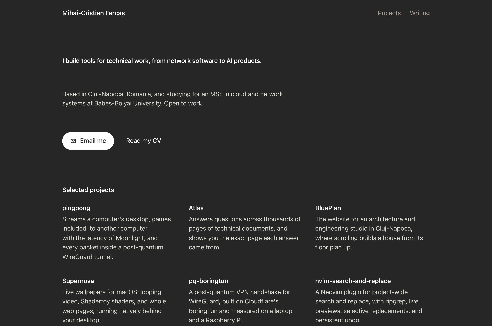

# mihaicristian.dev

My personal site — projects, a bit of writing, and not much else. White paper,
black ink, the system font at a single size. Built with [Astro](https://astro.build),
hand-written CSS, and no component libraries.



Live at [mihaicristian.dev](https://mihaicristian.dev).

## Running it

```sh
bun install
bun dev
```

Then open http://localhost:4321. Other scripts:

- `bun run build` — build the static site to `dist/`
- `bun run preview` — serve the build locally
- `bun run check` — type-check the Astro and TypeScript files

Any recent Node works too if you'd rather use `npm`.

## Layout

```
src/
  components/   ProjectGrid, PostList, Pager, Back, Shot, and pages/ for each page's body
  content/      the projects and the writing, as Markdown/MDX
  data/         site metadata (site.ts), the quote list (quotes.ts), and queries
  layouts/      Base.astro — the shared <head>, footer, and load gate
  pages/        index, the 404, /projects, /writing, and the RSS feed
  styles/       global.css — colors, type, layout, and the reset
```

## Writing a post

Drop an `.mdx` (or `.md`) file into `src/content/writing/`. The filename becomes
the URL slug. Each post needs a little frontmatter:

```mdx
---
title: 'Be Curious'
description: 'A line for the listing and the RSS feed.'
date: 2025-02-13
draft: false   # optional — drafts are hidden in production
---

Your words here.
```

New posts show up on the home page, the `/writing` timeline, and in `rss.xml`
automatically, newest first.

## A few notes on the design

- **One font size.** Everything is set at 17px in the system font; hierarchy
  comes from weight, color, and space. Links are plain text, underlined on
  hover. Pages share one rhythm of 34px lines: every gap is a whole number of
  them. Sections sit four lines apart. A project or a post is its title, then
  its content as one section: text and pictures two lines apart, a caption
  one line under its picture, paragraphs one line apart.
- **Light and dark** come straight from the system preference. Dark is a warm
  gray with white text, after macOS. Screenshots with a theme of their own
  (a terminal, a chart) ship a version for each.
- **Pages arrive whole.** Nothing loads lazily: every page holds until its
  fonts, images, video posters and recordings have all loaded, then fades in
  once. Client-side navigation loads the next page's media before swapping it
  in, and the recordings come in as copies already loaded.

Everything degrades gracefully: with JavaScript off, the pages render as
normal and the recordings show their first frame.
