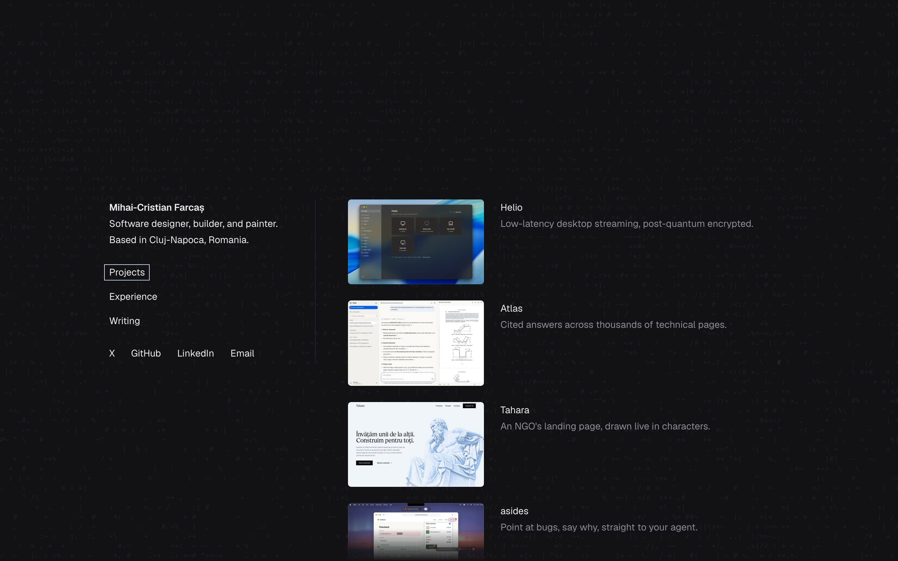

# mihaicristian.dev

My personal site — projects, a bit of writing, and not much else. Paper and ink
in Geist, over a field of characters that only shows under the pointer. Built with [Astro](https://astro.build), hand-written CSS, and no
component libraries.



Live at [mihaicristian.dev](https://mihaicristian.dev).

## Running it

```sh
bun install
bun dev
```

Then open http://localhost:4321. Other scripts:

- `bun run build` — build the static site to `dist/`
- `bun run preview` — serve the build locally
- `bun run check` — type-check the Astro and TypeScript files
- `node --test scripts/` — test the worker

Any recent Node works too if you'd rather use `npm`.

## Layout

```
src/
  components/   ProjectList, PostList, Pager, Shot, and pages/ for each page's body
  content/      the projects and the writing, as Markdown/MDX
  data/         site metadata (site.ts), the quote list (quotes.ts), and queries
  layouts/      Base.astro — the shared <head>, the side, the field, and the load gate
  pages/        index, the 404, /projects, /writing, /experience, and the RSS feed
  scripts/      the background field, smooth scrolling, and the buttons' borders
  styles/       global.css — the design tokens and every component
docs/           the design system and how the site runs
worker/         the Cloudflare Worker in front of the static files
```

Contributing, by hand or with an AI agent: start with [AGENTS.md](AGENTS.md),
then [docs/design.md](docs/design.md) and [docs/architecture.md](docs/architecture.md).

## Writing a post

Drop an `.mdx` (or `.md`) file into `src/content/writing/`. The filename becomes
the URL slug. Each post needs a little frontmatter:

```mdx
---
title: 'Be Curious'
description: 'A line for the listing and the RSS feed.'
date: 2025-02-13
draft: false   # optional — drafts are hidden in production
---

Your words here.
```

New posts show up on the `/writing` timeline and in `rss.xml` automatically,
newest first.

## A few notes on the design

- **A small, strict system.** Every color, size and space is a token in
  `global.css`. Three text sizes, one per kind of text. Five kinds of vertical
  space on a 26px line, from half a line between a list's short entries to
  four lines between sections. Hierarchy comes from gray and space, and the
  name is the only bold. The rules are in [docs/design.md](docs/design.md).
- **Light and dark** come straight from the system preference: white paper,
  or a very dark neutral gray. The one accent is a soft blue, `#d1dff6`, for
  focus rings, selection and the buttons' borders.
- **Buttons draw their own border.** Under the pointer, two corners grow
  along their edges. A click carries them round to a full border, which stays
  on the page you're on.
- **The background** is a floor of characters on a canvas round the page,
  empty in an ellipse over the middle, where the page is read. At rest it's
  plain paper; the pointer brings the characters up around it, leaving a
  short trail, and turns up words, lines of Seneca, formulas from computer
  science and a hunt round the corners. It draws only what changes, and
  nothing at rest.
- **Pages arrive whole.** Nothing loads lazily: every page holds until its
  fonts, images, video posters and recordings have all loaded, then fades in
  once. Client-side navigation loads the next page's media before swapping it
  in, and the recordings come in as copies already loaded.

Everything degrades gracefully: with JavaScript off, the pages render as
normal and the recordings show their first frame.
